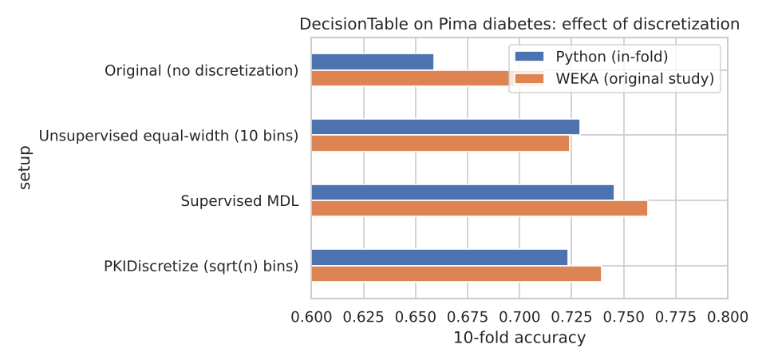

# Discretization and the DecisionTable Classifier

Does binning continuous attributes help a rule-based classifier? We first ran this study in WEKA as a team. I then rebuilt it in Python from scratch, including the DecisionTable classifier and all three discretizers, and added a check for data leakage.



## Data

Pima Indians Diabetes (`diabetes.arff`, included in `data/`): 768 patients, 8 numeric attributes, 35% tested positive.

## Setup

- **Classifier:** DecisionTable (Kohavi, 1995). Selects a subset of attributes and predicts the majority class of matching training rows, falling back to the overall majority
- **Discretizers:** none (baseline), unsupervised equal-width (10 bins), supervised MDL (Fayyad and Irani, 1993), PKIDiscretize (√n equal-frequency bins)
- **Evaluation:** 10-fold cross-validation. The Python version repeats it 5 times and fits each discretizer inside the folds

## Results

| Version | WEKA (original study) | Python (in-fold, 5×10 CV) |
|---|---:|---:|
| Original, no discretization | 71.22% | 65.88% |
| Unsupervised equal-width | 72.39% | 72.92% |
| **Supervised MDL** | **76.17%** | **74.56%** |
| PKIDiscretize | 73.95% | 72.34% |

- Every discretized version beats the raw data. On continuous values almost every case is unique, so the table rarely finds a match.
- Supervised MDL is best in both versions, because its cut points are chosen to separate the classes.
- **Leakage check:** fitting MDL on the full dataset before cross-validation (easy to do in WEKA's Preprocess tab) raises accuracy to 77.81%, a 3.25-point optimistic bias. Supervised filters belong inside the cross-validation loop. Part of the original WEKA gain may come from this effect.
- The final table uses plasma glucose, BMI, age and diabetes pedigree.

Numbers differ from WEKA because this DecisionTable uses greedy forward selection instead of best-first search, and the folds differ. The ranking of methods is the same.

## Files

| File | Contents |
|---|---|
| `discretization_study.ipynb` | Python implementation and experiments |
| `data/diabetes.arff` | Dataset |
| `DATA MINING CS619.pptx` | Original WEKA presentation |

## How to run

```bash
git clone https://github.com/mehtesham13/discretization-decision-table.git
cd discretization-decision-table
pip install -r requirements.txt
jupyter notebook discretization_study.ipynb
```

## Team (WEKA study)

Muhammad Ehtesham, Arifa Farhath, Bhavesh, Shivam, Nitish, Yogesh. Python reproduction by Muhammad Ehtesham.
